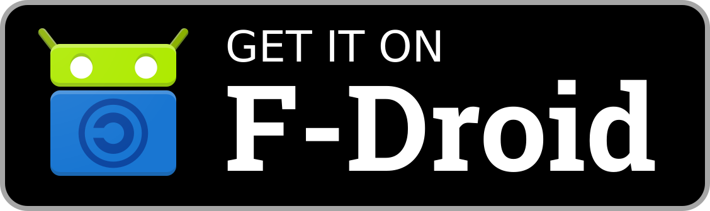
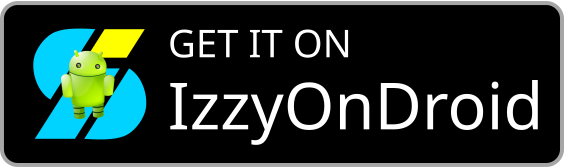
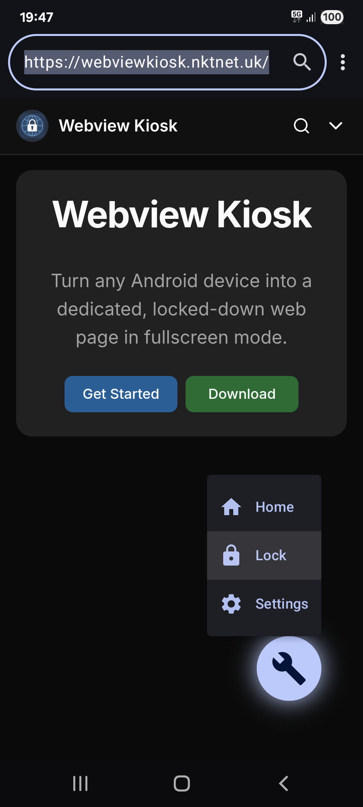
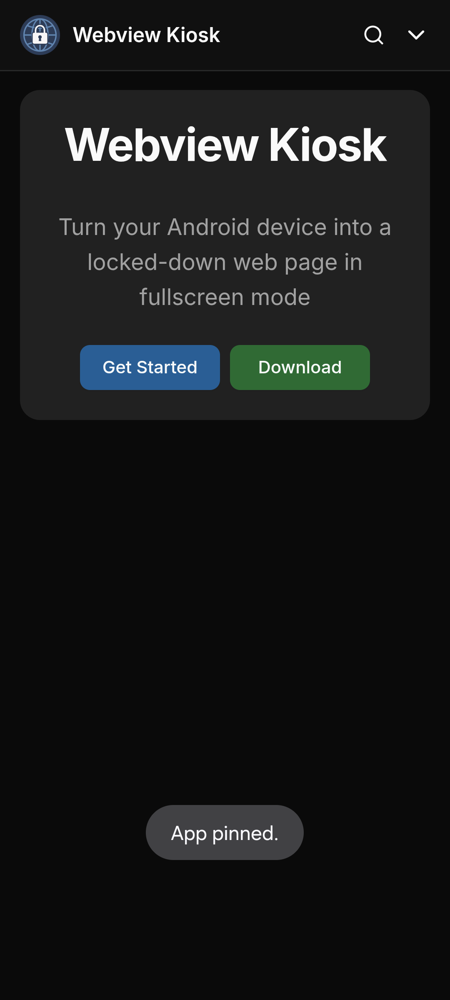
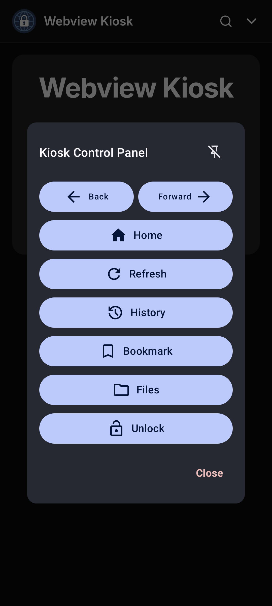
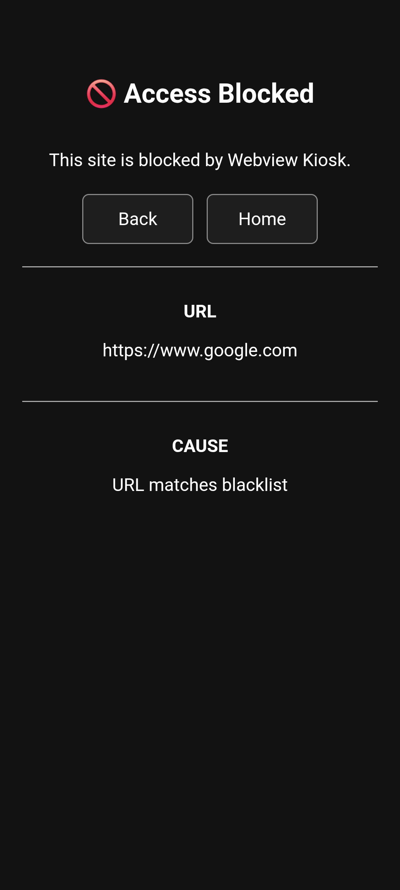
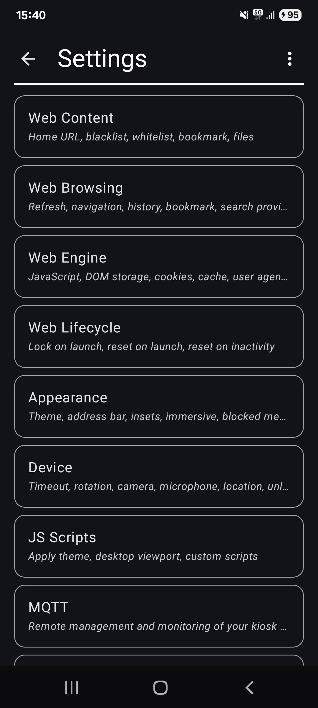
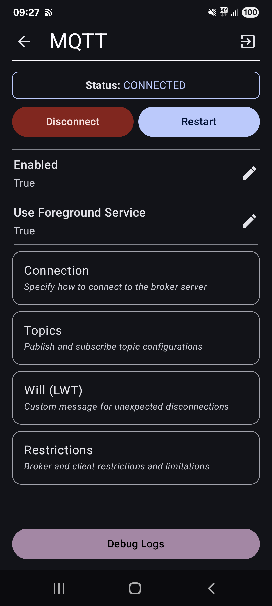

> [!WARNING]
>
> Google's new developer verification requirements for 2026-2027 will
> mean the end for side-loading and many alternate stores and projects
> such as F-Droid and New Pipe.
>
> For more information, please refer to the following sources:
>
> - F-Droid: https://f-droid.org/en/2025/10/28/sideloading.html
> - Keep Android Open: https://keepandroidopen.org
> - Video context: https://www.youtube.com/watch?v=wRvqdLsnsKY

# Webview Kiosk

> Docs: https://webviewkiosk.nktnet.uk

Webview Kiosk is a free and open-source Android application for secure,
kiosk-style web browsing.

It can function as digital signage, a kid-friendly restricted browser, an
immersive web reader, an interactive sign-up form, a home assistant dashboard,
or simply a wall clock.

Designed for small businesses and device owners who are looking for a simple
and standalone Kiosk solution.

## Key Features

### Core / Standalone

- <b>Lock Task Mode (Pin):</b> prevent access to your device's home screen, apps and status bar
- <b>Secure Settings:</b> configurations are protected by biometrics, device credentials or custom password
- <b>URL Filtering:</b> use regular expressions to control web access through a URL blacklist and whitelist
- <b>Export/Import:</b> backup and restore user settings in Base64 or JSON format
- <b>Local files:</b> display images, audio, video, HTML or PDF (using Mozilla's PDF.js) in kiosk mode
- <b>Default Launcher:</b> use as the home app and launch other apps in lock task mode (kiosk)
- <b>JS Scripts:</b> supports NFC (Near Field Communication), Eruda console, Dark Reader and custom scripts
- <b>Adblock:</b> blocks ads and trackers using rules from uBlock Origin, AdGuard, EasyList and HaGeZi

### Remote Management / Enterprise

1. MQTT (Message Queuing Telemetry Transport)
   - Monitor events, update settings, execute commands and build custom automations
   - Requires an MQTT broker (e.g. Mosquitto, EMQX, HiveMQ, or their HomeAssistant integrations)

2. UnifiedPush
   - Send commands and update settings via a decentralised push notification system
   - Requires a distributor application (e.g. sunup, ntfy, gCompat-UP)

3. Managed Configurations (App Restrictions)
   - For fully-managed (company-owned) devices, settings can be configured via an MDM/EMM provider
   - Advanced users with a device policy controller (e.g. Test DPC or OwnDroid) can also enforce configurations locally

## Permissions

- <b>INTERNET</b>: general web browsing
- <b>ACCESS_NETWORK_STATE</b>: refresh web pages when network connectivity is restored
- <b>ACCESS_LOCAL_NETWORK</b>: (optional, Android 17+) web apps needing LAN
- <b>CAMERA</b>: (optional) web apps requiring photo/video capture
- <b>RECORD_AUDIO</b>: (optional) web apps requiring audio capture
- <b>MODIFY_AUDIO_SETTINGS</b>: routing audio - needed for microphone
- <b>ACCESS_FINE_LOCATION</b>: (optional) web apps requiring precise geolocation
- <b>ACCESS_COARSE_LOCATION</b>: (optional) web apps requiring approximate geolocation
- <b>NFC</b>: read/write NFC tags using hardware
- <b>VIBRATE</b>: (optional) web apps requiring navigator.vibrate(pattern)
- <b>INSTALL_SHORTCUT</b>: home screen launcher shortcuts on Android 7.1 and below
- <b>QUERY_ALL_PACKAGES</b>: find launchable apps, device owners and lock task packages
- <b>POST_NOTIFICATIONS</b>: (optional) for lock task mode launches and MQTT
- <b>FOREGROUND_SERVICE</b>: persistent notification for required services
- <b>FOREGROUND_SERVICE_SPECIAL_USE</b>: return mechanism after opening apps in kiosk
- <b>FOREGROUND_SERVICE_MEDIA_PLAYBACK</b>: background audio/video streaming, e.g. YouTube
- <b>USE_BIOMETRIC</b>: replaces USE_FINGERPRINT from Android 9.0 onwards
- <b>USE_FINGERPRINT</b>: fingerprint hardware for authentication
- <b>WAKE_LOCK</b>: (optional) wake screen when receiving MQTT commands
- <b>WRITE_EXTERNAL_STORAGE</b>: download files in Android 9.0 and below
- <b>API (Dhizuku)</b>: request shared owner privileges
- <b>API_23 (Shizuku)</b>: auto-activate device/profile owner

## Installation Notes

From [v0.17.0](https://github.com/nktnet1/webview-kiosk/releases/tag/v0.17.0),
Google Play's [automatic protection](https://support.google.com/googleplay/android-developer/answer/10183279)
has been intentionally <b>disabled</b> to allow installations from the Aurora Store.

From [v0.15.7](https://github.com/nktnet1/webview-kiosk/releases/tag/v0.15.7),
the package name for all installation sources except the Google Play Store has
changed from `com.nktnet.webview_kiosk` to `uk.nktnet.webviewkiosk`.

## Contact

- support@webviewkiosk.nktnet.uk

## License

This project is licensed under the GNU Affero General Public License v3.0 or later.

See the [LICENSE](./LICENSE) file for details.

## Screenshots

  &nbsp;
  &nbsp;
  &nbsp;
  &nbsp;
  &nbsp;
  

## Alternatives

- [Fully Kiosk Browser Lockdown](https://www.fully-kiosk.com) (feature-rich, but not a free kiosk solution)
- [Web Kiosk](https://github.com/screenlite/web-kiosk) (by Screenlite)
- [FreeKiosk](https://github.com/RushB-fr/freekiosk) (by Rushb-fr)
- [Kite AOS](https://github.com/andrew-malitchuk/kite-aos) (by andrew-malitchuk)
